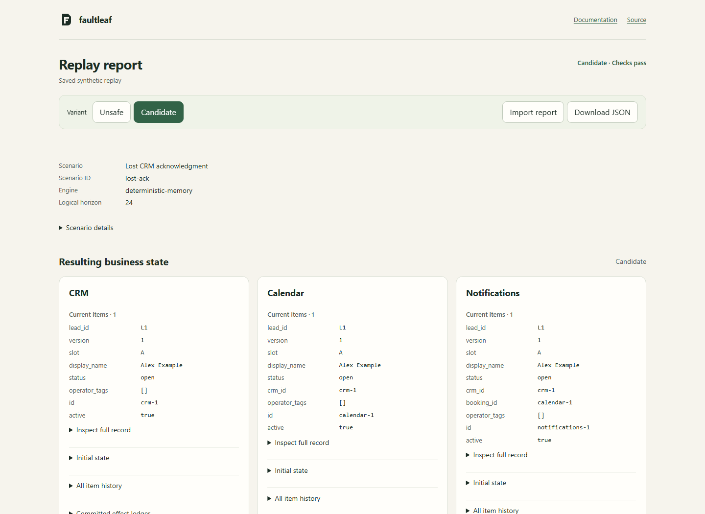

# Faultleaf

Replay a synthetic lead-to-appointment workflow against CRM, calendar and notification sandboxes. Inspect committed effects, classify business-state failures, compare an unsafe workflow with a durable candidate and reduce a failing event sequence.

[Saved replay demo](https://bglglzd.github.io/faultleaf/)



## Try a replay

Python 3.11 or newer. From this checkout:

```sh
python -m venv .venv
```

Activate with `source .venv/bin/activate` on Linux/macOS or `.venv\Scripts\Activate.ps1` in PowerShell, then:

```sh
python -m pip install .
faultleaf replay FL04 --reduce --out reports/lost-ack
```

Open `reports/lost-ack/report.html`. CRM commits a contact but loses its acknowledgment. The unsafe retry creates another contact; the candidate reuses its operation key and completes one consistent appointment. The JSON includes service snapshots, attempts, committed writes, exact violations and the logical timeline. All data is synthetic; no real messages are sent.

```sh
faultleaf list
faultleaf replay FL20 --http --out reports/restart-backoff
faultleaf suite --repeat --out reports/suite.json
faultleaf process-check --scenario FL19 --out reports/process.json
```

`--http` runs three real loopback listeners. The default replay calls the same stores directly with a logical clock. `process-check` terminates an actual worker process after an external write and launches another process against the same SQLite file. A failing unsafe run is expected; `replay` exits zero only when the candidate passes. `suite` also requires every declared mutation's exact target to be detected.

For a reduction that removes redundant tokens:

```sh
faultleaf replay examples/lost-ack.yaml --reduce --out reports/reduced
```

The reducer retains authoritative events, required faults, horizon and exact failure signature. Its minimality result applies only to optional single-token deletions in this grammar; a budget limit is reported explicitly.

## Checked behavior

The [24 YAML scenarios](docs/scenarios.md) declare expected state separately from worker implementation. They cover repeated deliveries and business revisions, lost acknowledgments at all three services, logical Retry-After, pending horizons, out-of-order revisions, operator close/priority, rescheduling, restart checkpoints and cross-lead isolation. The oracle checks both final state and retained history. A duplicate later cancelled or an early false completion later repaired remains a failure.

The candidate persists receipts, latest intent, progress and next retry in SQLite. Services keep a separate ledger of attempts and committed effects. Calendar/queue references must resolve to the current upstream records. A higher-version operator close retains the contact, cancels the booking and withdraws the synthetic confirmation. Normal requests preserve operator-owned fields.

The optional [n8n adapter](docs/n8n.md) uses a fixed export of explicit HTTP nodes with a separately installed runtime. Python replay results do not establish that n8n executed. See that document for the supported subset and runtime limits.

## Scope

One synthetic process and three intentionally inspectable APIs. This is not a general production trace replayer, CRM or arbitrary-workflow chaos platform. Idempotent effects are demonstrated within these APIs; exactly-once delivery and external vendor compatibility are not claimed. Pending work beyond the declared horizon is a valid result, distinct from success. The offline HTML viewer imports local saved reports; it does not execute workflows in a browser.

[Architecture and API](docs/architecture.md) · [Acceptance specification](docs/spec.md) · [Contributing](CONTRIBUTING.md) · [Changelog](CHANGELOG.md) · [MIT license](LICENSE)
