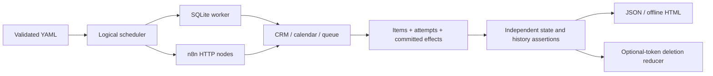

# Replay boundaries

The scheduler advances integer ticks, not wall-clock sleeps. Semantic service/operation/lead/version/occurrence selectors pin faults even when optional schedule tokens are deleted. After-commit barriers fire after the service SQLite transaction commits. A lost acknowledgment commits an effect, then the HTTP server closes the connection without response headers. A 429 creates a persisted logical no-write window. Service attempts and effects are separate records.

The Python candidate persists receipts, latest intents, jobs, phase, attempts and next due tick in SQLite. Every service acknowledgment checkpoints one phase. Unknown outcomes reuse the same service/lead/version/action key. A new revision supersedes unfinished old work; before each continuation the candidate checks operator status. Operator close retains the contact, cancels the active synthetic booking and withdraws the queue item. Normal requests preserve operator priority/tags and cannot reopen a closed lead. No messages are sent.

The intentionally unsafe variants are executable changes to deduplication, operation identity, completion, revision/manual guards, durable storage, retry timing or lead isolation. They do not return canned violation objects. The oracle reads the three stores and retained writes, rather than trusting workflow success. It compares predeclared expected active rows, current references and worker claims; duplicate history and obsolete confirmations remain witnesses after cleanup. The YAML fixtures and mutation target signatures are public.

`deterministic-memory` uses direct calls to the same stores. `loopback-http` uses three real HTTP listeners and independent GET snapshots. Default restart scenarios replace the worker instance and reopen its SQLite file. `process-check` separately launches a Python process, terminates it with exit 73 after an external commit and before its local checkpoint, then launches a different process using the same file. That is distinct process evidence; it is not inferred from instance reopening.

The n8n adapter is a separate fixed HTTP graph. It is not a general n8n workflow evaluator. Its supported real-runtime subset and isolation instructions are in [n8n.md](n8n.md). The input endpoint returns data only. No Code node delegates the workflow back to Python.

## Reduction

The bounded reducer deletes only optional delivery, restart or wake tokens. Initial state, authoritative fact records, semantic fault rules and observation horizon stay fixed. Each trial runs both the unsafe variant and repaired candidate. Acceptance requires the exact class/rule/service/lead/version signature, every required fault, all pinned schedule anchors and a passing repaired control. Exceptions cannot satisfy this predicate. A completed final single-deletion sweep proves deletion-minimality only within the permitted token grammar. A replay budget exhaustion explicitly leaves minimality unproven; there is no global-minimum claim.

## API

All listeners bind to ephemeral `127.0.0.1` ports and close with their owning context. They have no production credentials and are deliberately synthetic; do not expose them on a network.

| Endpoint | Behavior |
| --- | --- |
| `GET /state` | Current/history items, attempts and retained committed effects |
| `GET /items/<lead>` | Active records for that lead |
| `PUT /items/<lead>` | Keyed upsert with version fence; CRM preserves operator fields |
| `DELETE /items/<lead>` | Keyed cancellation/withdrawal |
| `POST /items` | Intentionally unsafe unkeyed creation; duplicates are allowed |

POST with `X-Faultleaf-Write-Mode: replace` deliberately replaces active rows without revision/operator guards; it is used only by the faulty baseline. It exists so server uniqueness cannot silently repair a faulty client. PUT/DELETE require `Idempotency-Key`; conflicting reuse returns 409. `X-Faultleaf-Event` and `X-Faultleaf-Tick` bind attempts to delivery and logical time. Bodies contain `lead_id`, `version`, `slot`, `display_name`, `status`; calendar and queue records retain `crm_id`, and queue records also retain `booking_id`.

Canonical digests cover the observable run, including ordered logical events, state and violations. Wall-clock time, machine, ports and subprocess PIDs are separate provenance. These synthetic stores do not prove exactly-once delivery, external vendor compatibility or correctness of arbitrary production workflows.
